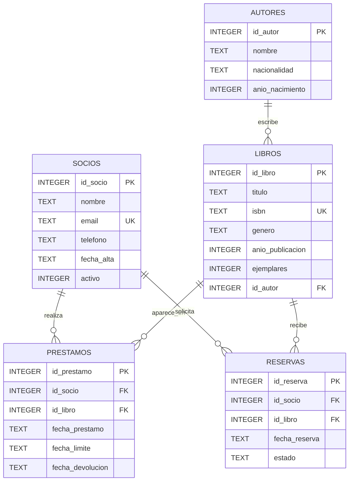

# PRÁCTICA EVALUABLE — BIBLIOGEST

**Asignatura:** Acceso a datos / Persistencia Java  
**Tecnologías:** Java 17, Maven, SQLite, JPA/Hibernate, JUnit 5  
**Actividad:** completar cinco DAO, implementar consultas de varios niveles y superar una batería de autoevaluación.

## 1. Situación y objetivo

El Ayuntamiento necesita informatizar la gestión de una biblioteca municipal. El sistema debe registrar **socios**, **autores**, **libros**, **préstamos** y **reservas**. Debe permitir gestionar los registros, saber qué libros están disponibles, identificar préstamos vencidos y obtener informes de actividad.

Se entrega un proyecto Maven con modelos de dominio, entidades JPA, mappers, configuración de Hibernate y cinco clases DAO parcialmente implementadas. **Tu trabajo consiste en completar los métodos `TODO` de los DAO y justificar las consultas SQL utilizadas.** No debes sustituir la arquitectura ni crear un paquete `repository`.

## 2. Modelo relacional de la base de datos



### Restricciones

- Las claves primarias numéricas se generan automáticamente; el resto de claves foráneas deben referenciar filas existentes.
- `socios.email` y `libros.isbn` son únicos; los nombres obligatorios no pueden ser nulos.
- `socios.activo` solo admite 0 (inactivo) o 1 (activo).
- `libros.ejemplares` no puede ser negativo.
- La fecha límite no puede preceder a la del préstamo; una devolución no puede preceder a la fecha del préstamo.
- `reservas.estado` solo admite `PENDIENTE`, `ATENDIDA` o `CANCELADA`.
- Las relaciones usan `ON DELETE RESTRICT`: se impedirá borrar registros que tengan referencias cuando esté activada la comprobación de claves foráneas.
- Las fechas se expresan en formato `YYYY-MM-DD` y SQLite debe tener activado `PRAGMA foreign_keys = ON` **en cada conexión**.

## 3. Estructura del proyecto

```text
src/main/java/es/ejemplo/biblioteca/
├── modelo/             Socio, Autor, Libro, Prestamo, Reserva
├── dao/                SocioDao, AutorDao, LibroDao, PrestamoDao, ReservaDao
├── orm/
│   ├── config/         OrmFactory
│   ├── entity/         Entidades JPA
│   └── mapper/         Conversión modelo ↔ entidad
├── infra/              ConexionBD
└── app/                Main
src/main/resources/
├── schema.sql
├── datos_iniciales.sql
└── META-INF/persistence.xml
src/test/java/es/ejemplo/biblioteca/    Pruebas JUnit
config/nota/                          Reglas Checkstyle y PMD
calcular_nota.py                      Autoevaluación invocada por Maven
```

### Reglas arquitectónicas

1. **No crear `repository`, `IRepository`, `AbstractOrmRepository` ni clases equivalentes.**
2. Implementar persistencia y consultas directamente dentro de los cinco DAO mediante `EntityManager`.
3. Separar los objetos del paquete `modelo` de las entidades JPA; utilizar los mappers ya proporcionados.
4. Respetar las firmas públicas que aparecen en cada clase DAO; no modificar las pruebas ni el contrato de los métodos.
5. Usar JPQL y parámetros para las consultas implementadas en Java; no concatenar entradas de usuarios en consultas.
6. Abrir y cerrar correctamente el `EntityManager` y realizar `begin`/`commit`/`rollback` en operaciones de escritura.
7. Gestionar **dentro de los DAO** las excepciones de persistencia, registrando el problema sin propagarlas a la aplicación.

### Contrato de retorno

| Operación | Éxito | Fallo, registro ausente o error controlado |
|---|---|---|
| `insertar(objeto)` | Identificador generado (positivo) | `0` |
| `actualizar(objeto)` | `1` | `0` |
| `eliminar(id)` | `1` | `0` |
| `buscarPorId(id)` | `Optional` con registro | `Optional.empty()` |
| Consultas que devuelven listas | Lista de resultados | Lista vacía |
| Consultas de conteo | Cantidad calculada | `0` según contrato |

**Nota:** una lista vacía o un valor `0` pueden corresponder tanto a ausencia de resultados como a una incidencia; por eso es importante registrar los errores en el DAO.

## 4. Operaciones que debes implementar

### SocioDao

**CRUD:** `listar`, `buscarPorId`, `insertar`, `actualizar`, `eliminar`.

**Consultas adicionales:** `listarActivos`, `buscarPorEmail`, `listarConPrestamosVencidos`, `sociosSinPrestamos`, `rankingSocios`, `historialSocio`.

### AutorDao

**CRUD:** `listar`, `buscarPorId`, `insertar`, `actualizar`, `eliminar`.

**Consultas adicionales:** `buscarPorNacionalidad`, `contarLibrosPorAutor`, `autoresConRecuento`, `autoresLeidosPorTresSocios`.

### LibroDao

**CRUD:** `listar`, `buscarPorId`, `insertar`, `actualizar`, `eliminar`.

**Consultas adicionales:** `buscarPorGenero`, `buscarPorAutor`, `buscarPorTitulo`, `listarDisponibles`, `librosDesdeAnio`, `generos`, `nuncaPrestados`, `masPrestadosQueMedia`, `reservadosSinDisponibilidad`, `librosConAutor`, `contarPorGenero`, `prestamosPorGeneroMinimo`, `disponibilidadPorLibro`, `estadisticasGenero`.

### PrestamoDao

**CRUD:** `listar`, `buscarPorId`, `insertar`, `actualizar`, `eliminar`.

**Consultas y acciones adicionales:** `listarPorSocio`, `listarActivos`, `listarVencidos`, `contarPrestamosPorLibro`, `prestamosConSocioYLibro`, `rankingMensual`, `registrarPrestamo`, `devolver`.

### ReservaDao

**CRUD:** `listar`, `buscarPorId`, `insertar`, `actualizar`, `eliminar`.

**Consultas adicionales:** `listarPendientes`, `buscarPorSocio`, `listarPorLibro`, `contarReservasPendientes`, `reservasConDetalles`, `prioridadReservas`.

**Importante:** consulta las firmas exactas del proyecto para conocer los argumentos, tipos y resultados de cada método; no son todos `List<T>`.

## 5. Actividades SQL: 25 retos de dificultad progresiva

**Nivel 1 — Selección, filtros y ordenación**

1. Libros ordenados por título.
2. Socios activos ordenados por fecha de alta descendente.
3. Libros cuyo título contiene el texto indicado.
4. Libros publicados desde un año concreto y de un género determinado.
5. Géneros distintos registrados en el catálogo.

**Nivel 2 — Relaciones entre tablas**

6. Libros con nombre y nacionalidad del autor.
7. Préstamos con socio, libro y fechas.
8. Préstamos activos de un socio.
9. Socios que nunca han realizado préstamos.
10. Reservas pendientes con nombre del socio, título y autor.

**Nivel 3 — Agregaciones y estadísticas**

11. Cantidad de libros por género.
12. Cantidad de libros por autor, incluyendo autores sin libros.
13. Cinco socios con más préstamos.
14. Géneros con más de cinco préstamos históricos.
15. Por libro: ejemplares totales, prestados actualmente y disponibles.

**Nivel 4 — Subconsultas y casos especiales**

16. Libros que nunca se han prestado.
17. Socios con préstamos vencidos en una fecha de referencia.
18. Libros con más préstamos históricos que la media del catálogo (incluidos los libros sin préstamos al calcular la media).
19. Autores cuyos libros han sido prestados por al menos tres socios distintos.
20. Libros con reservas pendientes que no tienen ejemplares disponibles.

**Nivel 5 — Informes y transacciones**

21. Ranking de los tres libros más prestados de un mes indicado, con autor y cantidad de préstamos.
22. Historial completo de préstamos de un socio, indicando devoluciones y retrasos.
23. Reserva pendiente más antigua de cada libro.
24. Estadísticas por género: títulos, ejemplares, préstamos históricos y préstamos activos.
25. Registro atómico de un préstamo: solo si el socio está activo y queda un ejemplar disponible; garantizar que no se superen los ejemplares cuando existan operaciones concurrentes.

**Entrega SQL:** completa el archivo `consultas.sql` identificando cada consulta con su número, mostrando el SQL equivalente a la consulta JPQL o a la operación implementada en el DAO. Para la 25, documenta los pasos SQL y el límite transaccional.

## 6. Reglas funcionales específicas

- No prestar un libro a un socio inactivo.
- No registrar más préstamos activos que ejemplares disponibles.
- Un préstamo está activo cuando `fecha_devolucion IS NULL`.
- Un préstamo está vencido cuando sigue activo y `fecha_limite` es anterior a la fecha de referencia.
- La devolución debe actualizar el préstamo existente y respetar las fechas.
- Los cambios de escritura deben confirmarse de forma atómica; los errores deben producir `rollback`.
- Verificar que los identificadores externos existen y no permitir borrados que infrinjan restricciones.
- Registrar internamente las incidencias de persistencia, **sin lanzar excepciones desde las API públicas de los DAO**.

## 7. Batería de 100 pruebas independientes

| Clase de pruebas | N.º de tests | Puntos máximos |
|---|---:|---:|
| `SocioDaoTest` | 12 | 0,84 |
| `AutorDaoTest` | 12 | 0,84 |
| `LibroDaoTest` | 12 | 0,84 |
| `PrestamoDaoTest` | 12 | 0,84 |
| `ReservaDaoTest` | 12 | 0,84 |
| `ConsultasBasicasTest` | 5 | 0,35 |
| `ConsultasJoinTest` | 5 | 0,35 |
| `ConsultasAgrupacionTest` | 5 | 0,35 |
| `ConsultasAvanzadasTest` | 5 | 0,35 |
| `InformesTest` | 5 | 0,35 |
| `IntegridadTest` | 10 | 0,70 |
| `TransaccionesTest` | 5 | 0,35 |
| **TOTAL** | **100** | **7,00** |

Las pruebas por DAO comprobarán inserción, búsqueda por ID, listados, actualización, eliminación, operaciones sobre registros inexistentes, validaciones y filtros. Los grupos restantes comprueban las 25 consultas, las restricciones de SQLite y los comportamientos transaccionales. **Cada test debe poder ejecutarse de forma independiente y sobre una base aislada.**

### Cómo obtener el resultado

Desde la raíz del proyecto ejecuta exactamente:

```bash
mvn clean verify -Pnota
```

El perfil `nota` ejecuta las pruebas, genera informes de calidad y documentación, e invoca automáticamente el script de cálculo Python. El alumnado no tiene que ejecutarlo manualmente. Requiere JDK 17, Maven y Python 3 disponible con el nombre configurado en `pom.xml`.

Consulta los informes generados:

- `target/nota/informe-nota.md`: rúbrica explicada y errores detectados.
- `target/notas_por_bloques.txt`: resumen en texto.
- `target/nota/desglose-dao.csv`: nota de cada DAO y grupo.
- `target/nota/rubrica-completa.csv`: criterios de calidad y documentación.
- `target/nota/nota.csv`: suma final.

Si un test falla, revisa su nombre, el mensaje y la causa; modifica el código y vuelve a ejecutar el mismo comando. Si la aplicación no compila, no podrá calcularse una nota funcional válida.

## 8. Calidad de código: hasta 2 puntos

La autoevaluación utiliza **Checkstyle, PMD y CPD** con las reglas de `config/nota/`:

| Herramienta | Máximo | Qué examina |
|---|---:|---|
| Checkstyle | 0,55 | nombres de clases, métodos y variables; imports sin usar, imports `*`, bloques `catch` vacíos y tabuladores |
| PMD | 0,90 | complejidad ciclomática (referencia: 10 por método, 40 por clase), recursos no cerrados, variables o atributos sin utilizar, bloques `catch` vacíos |
| CPD | 0,55 | fragmentos de código duplicados (umbral configurado de 80 tokens) |
| **Total** | **2,00** | |

Recomendaciones: usa nombres expresivos, indenta y formatea con el editor, evita métodos demasiado complejos, no copies grandes bloques de código sin necesidad, cierra recursos mediante `try-with-resources`, utiliza parámetros en JPQL y evita tragar excepciones sin registrarlas. El formateo del editor no sustituye el análisis de calidad.

**La puntuación real depende de las reglas y del cálculo incluidos en el perfil Maven**, no de una revisión manual de estilo. Los archivos de evaluación y pruebas no deben modificarse.

## 9. Documentación Javadoc: hasta 1 punto

Solo se evalúa la documentación de la **API Java pública** de las clases DAO. No se solicita una memoria extensa. Documenta clases y métodos mediante bloques `/** ... */`, incluyendo:

- Descripción útil de la finalidad del método.
- `@param` para cada parámetro, cuando exista.
- `@return` para los métodos que devuelvan resultados, explicando valores de éxito y error.
- La gestión de errores, restricciones de operación y comportamiento ante registros inexistentes.
- Texto coherente con el comportamiento real de la API, no frases vacías.

Ejemplo orientativo:

```java
/**
 * Busca un socio utilizando su correo electrónico.
 *
 * @param email dirección de correo que se desea localizar
 * @return socio encontrado o Optional.empty() si no existe
 *         o no puede completarse la operación
 */
public Optional<Socio> buscarPorEmail(String email) {
    // Implementación del estudiante.
}
```

### Condición de desbloqueo

**El Javadoc solo suma puntos si se superan al menos 90 de los 100 tests funcionales.** Con 89 o menos, su contribución a la nota es 0, aunque la documentación esté escrita. El análisis puede seguir mostrando sugerencias para mejorarla.

## 10. Cálculo de la nota

| Bloque | Máximo |
|---|---:|
| Funcionalidad (100 tests) | 7,00 |
| Calidad (Checkstyle + PMD + CPD) | 2,00 |
| Javadoc de las API | 1,00 |
| **NOTA FINAL** | **10,00** |

Con `T` tests superados, `C` puntos de calidad (0–2) y `D` de Javadoc (0–1):

```text
Si T < 90:  nota = 0,07 × T + C
Si T ≥ 90:  nota = 0,07 × T + C + D
```

Ejemplo: 92 tests correctos (6,44), calidad 1,50 y Javadoc 0,80 ⇒ **8,74 / 10**.

## 11. Plan de desarrollo recomendado

1. Analiza el esquema y las restricciones, y revisa `modelo`, `entity` y `mapper`.
2. Implementa `SocioDao` y `AutorDao`, que no tienen relaciones salientes.
3. Implementa `LibroDao`, respetando la clave foránea del autor.
4. Implementa `PrestamoDao` y `ReservaDao`, respetando las dependencias de libros y socios.
5. Resuelve progresivamente las consultas de los cinco niveles en `consultas.sql` y en los métodos previstos.
6. Completa las operaciones de préstamo y devolución con transacciones y comprobación de disponibilidad.
7. Añade Javadoc a las API públicas y corrige las incidencias de Checkstyle, PMD y CPD.
8. Ejecuta `mvn clean verify -Pnota`, revisa el desglose por DAO y mejora la solución.

## 12. Entrega

Entrega el **proyecto Maven** con los DAO completados y el archivo `consultas.sql` resuelto. Conserva la estructura original y no modifiques los tests, la calculadora de notas ni las reglas oficiales. La evaluación final se realizará con una copia controlada de la batería y configuración del profesorado.

**Criterio de éxito:** aplicación funcional, consultas correctas, integridad y transacciones bien gestionadas, calidad suficiente y API documentada. No basta con que compile: deben superarse las pruebas.
