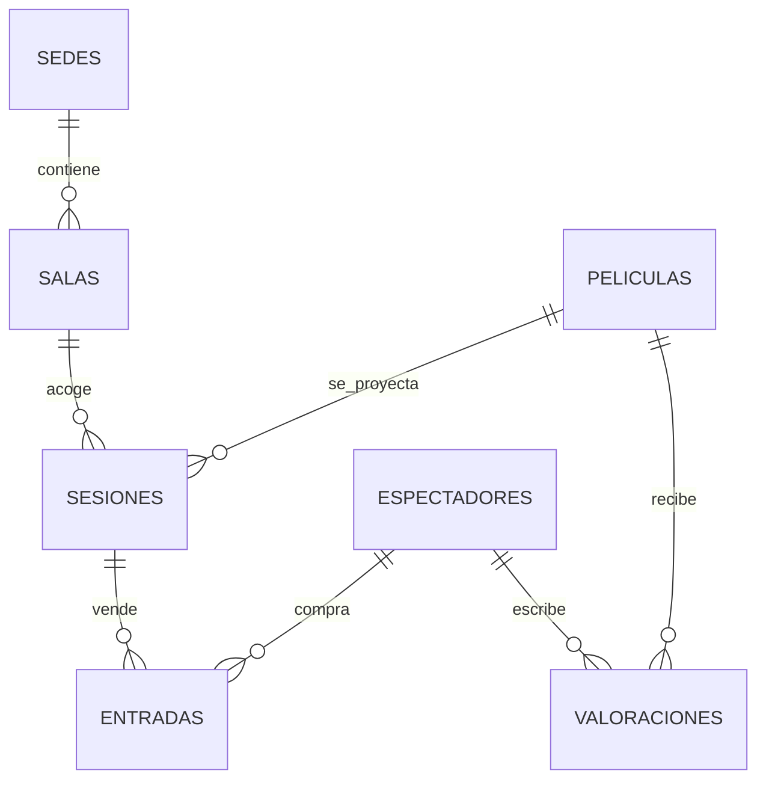

# PRÁCTICA DE REPASO — CINEFEST (ALUMNADO)

**Módulo:** Acceso a datos / Persistencia con Java  
**Tecnologías:** Java 17, Maven, SQLite, JPA/Hibernate y SQL  
**Objetivo:** desarrollar 7 DAO y resolver 30 retos SQL sobre una base relacional, con salidas de referencia.

> **Versión de alumnado:** los DAO y `consultas.sql` contienen `TODO`. Los ejemplos de salida son expectativas comprobables, **no soluciones SQL**. No se incluye una batería oficial de nota ni se simula que esté disponible.

## 1. Contexto y trabajo a entregar

La organización de un festival de cine controla **sedes, salas, películas, sesiones, espectadores, entradas y valoraciones**. Debe gestionar la cartelera, vender entradas, impedir sobreaforos, controlar cancelaciones y elaborar estadísticas. Son **7 tablas (dos más que BiblioGest)**.

Debes implementar los métodos sin resolver en los DAO, escribir las 30 consultas en `consultas.sql` (C01…C30) y documentar los métodos públicos con Javadoc. Mantén `modelo`, `orm/entity` y `orm/mapper` separados; implementa persistencia directamente desde los DAO mediante `EntityManager`. Para las consultas de varios campos (`List<Object[]>`), respeta exactamente el orden de columnas descrito abajo.

## 2. Modelo relacional



| Tabla | Clave primaria | Columnas principales y relaciones |
|---|---|---|
| `sedes` | `id_sede` | `nombre` (único), `municipio` |
| `salas` | `id_sala` | `nombre`, `aforo` (>0), `id_sede` → `sedes`; pareja (`id_sede`,`nombre`) única |
| `peliculas` | `id_pelicula` | `titulo`, `genero`, `duracion_min`, `pais`, `anio` |
| `sesiones` | `id_sesion` | `id_pelicula` → `peliculas`, `id_sala` → `salas`, `fecha`, `hora`, `precio`, `estado`; (`id_sala`,`fecha`,`hora`) única |
| `espectadores` | `id_espectador` | `nombre`, `email` (único), `fecha_alta`, `activo` (0/1) |
| `entradas` | `id_entrada` | `id_sesion` → `sesiones`, `id_espectador` → `espectadores`, `fecha_compra`, `estado`; (`id_sesion`,`id_espectador`) única |
| `valoraciones` | `id_valoracion` | `id_pelicula` → `peliculas`, `id_espectador` → `espectadores`, `puntuacion` (1–5), `comentario`, `fecha`; (`id_pelicula`,`id_espectador`) única |

**Restricciones:** `sesiones.estado` ∈ `PROGRAMADA`, `CANCELADA`, `FINALIZADA`; `entradas.estado` ∈ `PAGADA`, `USADA`, `CANCELADA`. Los importes son euros, las fechas `YYYY-MM-DD` y las horas `HH:MM`. Activa `PRAGMA foreign_keys=ON` **por conexión**. Todas las FK restringen el borrado si tienen referencias.

### Convenciones de consulta (obligatorias)

- **Entrada válida o venta válida:** estado `PAGADA` o `USADA`; las `CANCELADA` no cuentan para ocupación, ranking ni recaudación.
- **Aforo libre:** `aforo` − entradas válidas de esa sesión, independientemente del estado de la sesión. Las sesiones canceladas no se venden.
- Los informes de ingresos toman `sesiones.precio` como precio unitario, no un campo en `entradas`.
- Los recuentos que indican *incluyendo cero* deben mostrar filas sin relaciones (`LEFT JOIN`/subconsulta equivalente).
- Los empates se resuelven por las columnas de orden indicadas; no uses orden implícito.
- Las salidas se refieren a los **datos iniciales sin modificar**, salvo C29 y C30, que son casos de prueba independientes y deben ejecutarse desde una copia de la base inicial.

## 3. Estructura y ejecución

```text
cinefest-alumnado/
├── README.md
├── consultas.sql                 # C01…C30, para completar
├── datos/cinefest.sqlite3        # Base de ejemplo ya creada
├── pom.xml
└── src/main/
    ├── java/es/ejemplo/cinefest/
    │   ├── modelo/             # 7 clases POJO
    │   ├── dao/                # 7 DAO con TODO
    │   ├── orm/entity/         # 7 entidades JPA
    │   ├── orm/mapper/         # 7 mappers
    │   ├── orm/config/         # Factoría EntityManagerFactory
    │   └── app/                
    └── resources/
        ├── schema.sql
        ├── datos_iniciales.sql
        └── META-INF/persistence.xml
```

Para comenzar: `mvn test` (requiere Maven y JDK 21). El proyecto contiene **esqueletos para resolver**, por lo que compilar no demuestra que se hayan realizado las consultas. Puedes abrir `datos/cinefest.sqlite3` con SQLite y ejecutar allí SQL sobre una **copia** para no alterar las salidas de referencia. Para reconstruir la base desde cero, ejecuta `schema.sql` y después `datos_iniciales.sql` sobre una base vacía.

### Contrato general DAO

Cada DAO proporciona `listar`, `buscarPorId`, `insertar`, `actualizar`, `eliminar`; hay además métodos específicos listados en el código y en las consultas. Las operaciones CRUD deben devolver `id > 0` al insertar, `1` al actualizar o eliminar y `0` si no procede. Una búsqueda sin coincidencias devuelve `Optional.empty()`; listas sin resultados, lista vacía. Maneja errores de persistencia registrándolos dentro del DAO, sin propagarlos en sus API. Utiliza `EntityManager` y consultas parametrizadas en JPQL; abre y cierra cada contexto y aplica `begin`/`commit`/`rollback` en escrituras. Las restricciones deben comprobarse tanto en la lógica de negocio como en la BD cuando corresponda.

## 4. Retos SQL y resultados esperados

Cada reto especifica **tablas**, entradas (parámetros), **columnas exactas** y **ordenación**. Los ejemplos muestran las primeras filas salvo que se indique lo contrario; `∅` significa que no hay resultados. No se muestra SQL resuelto. En consultas con agregaciones usa el alias funcional de las columnas indicado.

### C01. Películas ordenadas alfabéticamente

**Tablas:** `peliculas`. **Parámetros:** ninguno.  
**Salida:** `titulo, genero, anio`. **Orden:** titulo ASC.

```text
titulo | genero | anio
Aurora | Animación | 2026
Bruma | Drama | 2022
Ecos | Documental | 2025
Horizonte | Drama | 2023
Islas Invisibles | Documental | 2026
```
**Total real:** 9 filas; se muestran las 5 primeras.

### C02. Espectadores activos por antigüedad

**Tablas:** `espectadores`. **Parámetros:** ninguno.  
**Salida:** `nombre, fecha_alta`. **Orden:** fecha_alta ASC, nombre ASC.

```text
nombre | fecha_alta
Ana | 2026-10-01
Bruno | 2026-10-02
Carla | 2026-10-03
Diego | 2026-10-04
Elena | 2026-10-05
```
**Total real:** 7 filas; se muestran las 5 primeras.

### C03. Películas de un género

**Tablas:** `peliculas`. **Parámetros:** genero = Drama.  
**Salida:** `titulo, pais, anio`. **Orden:** titulo ASC.

```text
titulo | pais | anio
Bruma | Chile | 2022
Horizonte | España | 2023
Mareas | España | 2024
```

### C04. Sesiones entre dos fechas

**Tablas:** `sesiones`. **Parámetros:** desde = 2026-11-13; hasta = 2026-11-14.  
**Salida:** `fecha, hora, id_sesion, precio`. **Orden:** fecha, hora, id_sesion ASC.

```text
fecha | hora | id_sesion | precio
2026-11-13 | 17:00 | 3 | 5.00
2026-11-13 | 19:00 | 4 | 6.00
2026-11-14 | 16:00 | 6 | 4.00
2026-11-14 | 18:00 | 5 | 7.00
```

### C05. Géneros distintos

**Tablas:** `peliculas`. **Parámetros:** ninguno.  
**Salida:** `genero`. **Orden:** genero ASC.

```text
genero
Animación
Ciencia ficción
Comedia
Documental
Drama
```

### C06. Salas con su sede

**Tablas:** `salas + sedes`. **Parámetros:** ninguno.  
**Salida:** `sede, sala, aforo`. **Orden:** sede, sala ASC.

```text
sede | sala | aforo
Auditorio Atlántico | Sala Azul | 5
Auditorio Atlántico | Sala Roja | 8
Centro Cultural Sur | Sala Dunas | 4
Cine del Puerto | Sala Volcán | 6
```

### C07. Sesiones con película, sala y sede

**Tablas:** `sesiones + peliculas + salas + sedes`. **Parámetros:** ninguno.  
**Salida:** `id_sesion, pelicula, sede, sala, fecha, hora`. **Orden:** id_sesion ASC.

```text
id_sesion | pelicula | sede | sala | fecha | hora
1 | Mareas | Auditorio Atlántico | Sala Azul | 2026-11-12 | 18:00
2 | Órbita | Auditorio Atlántico | Sala Roja | 2026-11-12 | 20:00
3 | Horizonte | Centro Cultural Sur | Sala Dunas | 2026-11-13 | 17:00
4 | Ecos | Cine del Puerto | Sala Volcán | 2026-11-13 | 19:00
5 | Mareas | Centro Cultural Sur | Sala Dunas | 2026-11-14 | 18:00
```
**Total real:** 12 filas; se muestran las 5 primeras.

### C08. Entradas con espectador y película

**Tablas:** `entradas + espectadores + sesiones + peliculas`. **Parámetros:** ninguno.  
**Salida:** `id_entrada, espectador, pelicula, estado`. **Orden:** id_entrada ASC.

```text
id_entrada | espectador | pelicula | estado
1 | Ana | Mareas | PAGADA
2 | Bruno | Mareas | PAGADA
3 | Carla | Mareas | PAGADA
4 | Diego | Mareas | PAGADA
5 | Elena | Mareas | CANCELADA
```
**Total real:** 22 filas; se muestran las 5 primeras.

### C09. Espectadores que nunca compraron entradas

**Tablas:** `espectadores + entradas`. **Parámetros:** ninguno.  
**Salida:** `nombre, email`. **Orden:** nombre ASC.

```text
nombre | email
Gabriel | gabriel@example.org
Hugo | hugo@example.org
```

### C10. Valoraciones con datos de película y espectador

**Tablas:** `valoraciones + peliculas + espectadores`. **Parámetros:** ninguno.  
**Salida:** `pelicula, espectador, puntuacion`. **Orden:** pelicula, espectador ASC.

```text
pelicula | espectador | puntuacion
Aurora | Carla | 5
Aurora | Elena | 4
Bruma | Elena | 4
Ecos | Bruno | 5
Horizonte | Ana | 5
```
**Total real:** 12 filas; se muestran las 5 primeras.

### C11. Número de películas por género

**Tablas:** `peliculas`. **Parámetros:** ninguno.  
**Salida:** `genero, total_peliculas`. **Orden:** genero ASC.

```text
genero | total_peliculas
Animación | 1
Ciencia ficción | 1
Comedia | 1
Documental | 3
Drama | 3
```

### C12. Número de salas y aforo total por sede, incluso sin salas

**Tablas:** `sedes + salas`. **Parámetros:** ninguno.  
**Salida:** `sede, total_salas, aforo_total`. **Orden:** sede ASC.

```text
sede | total_salas | aforo_total
Auditorio Atlántico | 2 | 13
Centro Cultural Sur | 1 | 4
Cine del Puerto | 1 | 6
```

### C13. Ranking de espectadores por entradas no canceladas

**Tablas:** `espectadores + entradas`. **Parámetros:** ninguno.  
**Salida:** `espectador, total_entradas`. **Orden:** total_entradas DESC, espectador ASC.

```text
espectador | total_entradas
Ana | 4
Bruno | 4
Carla | 4
Diego | 3
Elena | 3
```
**Total real:** 8 filas; se muestran las 5 primeras.

### C14. Películas con al menos dos valoraciones y su media

**Tablas:** `peliculas + valoraciones`. **Parámetros:** minimo = 2.  
**Salida:** `pelicula, numero_valoraciones, media`. **Orden:** media DESC, pelicula ASC.

```text
pelicula | numero_valoraciones | media
Mareas | 3 | 4.67
Aurora | 2 | 4.50
Horizonte | 2 | 4.50
Órbita | 2 | 3.50
```

### C15. Plazas vendidas y libres por sesión

**Tablas:** `sesiones + salas + entradas`. **Parámetros:** ninguno.  
**Salida:** `id_sesion, aforo, vendidas, libres`. **Orden:** id_sesion ASC.

```text
id_sesion | aforo | vendidas | libres
1 | 5 | 4 | 1
2 | 8 | 3 | 5
3 | 4 | 4 | 0
4 | 6 | 1 | 5
5 | 4 | 3 | 1
```
**Total real:** 12 filas; se muestran las 5 primeras.

### C16. Películas sin sesiones

**Tablas:** `peliculas + sesiones`. **Parámetros:** ninguno.  
**Salida:** `titulo`. **Orden:** titulo ASC.

```text
titulo
Islas Invisibles
```

### C17. Sesiones programadas sin ventas válidas

**Tablas:** `sesiones + peliculas + entradas`. **Parámetros:** ninguno.  
**Salida:** `id_sesion, pelicula, fecha`. **Orden:** id_sesion ASC.

```text
id_sesion | pelicula | fecha
9 | Bruma | 2026-11-16
12 | Ecos | 2026-11-17
```

### C18. Sesiones agotadas, sin contar cancelaciones

**Tablas:** `sesiones + peliculas + salas + entradas`. **Parámetros:** ninguno.  
**Salida:** `id_sesion, pelicula, aforo`. **Orden:** id_sesion ASC.

```text
id_sesion | pelicula | aforo
3 | Horizonte | 4
```

### C19. Películas con más ventas válidas que la media de las nueve películas (incluidas las de cero ventas)

**Tablas:** `peliculas + sesiones + entradas`. **Parámetros:** ninguno.  
**Salida:** `pelicula, entradas_validas`. **Orden:** entradas_validas DESC, pelicula ASC.

```text
pelicula | entradas_validas
Mareas | 7
Horizonte | 5
Órbita | 3
```

### C20. Espectadores con entradas válidas en al menos dos sedes

**Tablas:** `espectadores + entradas + sesiones + salas`. **Parámetros:** minimo = 2.  
**Salida:** `espectador, sedes_distintas`. **Orden:** sedes_distintas DESC, espectador ASC.

```text
espectador | sedes_distintas
Bruno | 3
Ana | 2
Carla | 2
Diego | 2
Elena | 2
```
**Total real:** 6 filas; se muestran las 5 primeras.

### C21. Top 3 de películas por recaudación de entradas válidas

**Tablas:** `peliculas + sesiones + entradas`. **Parámetros:** limite = 3.  
**Salida:** `pelicula, entradas_validas, recaudacion`. **Orden:** recaudacion DESC, pelicula ASC.

```text
pelicula | entradas_validas | recaudacion
Mareas | 7 | 45.00
Horizonte | 5 | 27.00
Órbita | 3 | 24.00
```

### C22. Recaudación por sede, incluyendo sedes sin ventas

**Tablas:** `sedes + salas + sesiones + entradas`. **Parámetros:** ninguno.  
**Salida:** `sede, recaudacion`. **Orden:** recaudacion DESC, sede ASC.

```text
sede | recaudacion
Auditorio Atlántico | 69.00
Centro Cultural Sur | 46.00
Cine del Puerto | 6.00
```

### C23. Ventas diarias, excluyendo entradas canceladas

**Tablas:** `entradas + sesiones`. **Parámetros:** ninguno.  
**Salida:** `fecha_compra, entradas_validas, total`. **Orden:** fecha_compra ASC.

```text
fecha_compra | entradas_validas | total
2026-11-01 | 2 | 12.00
2026-11-02 | 3 | 22.00
2026-11-03 | 2 | 14.00
2026-11-04 | 3 | 16.00
2026-11-05 | 3 | 21.00
```
**Total real:** 9 filas; se muestran las 5 primeras.

### C24. Historial de entradas de un espectador

**Tablas:** `entradas + sesiones + peliculas`. **Parámetros:** id_espectador = 1.  
**Salida:** `pelicula, fecha_sesion, estado_entrada, precio`. **Orden:** fecha_sesion ASC, pelicula ASC.

```text
pelicula | fecha_sesion | estado_entrada | precio
Mareas | 2026-11-12 | PAGADA | 6.00
Órbita | 2026-11-12 | PAGADA | 8.00
Horizonte | 2026-11-13 | PAGADA | 5.00
Aurora | 2026-11-14 | PAGADA | 4.00
```

### C25. Informe por fecha de sesión, incluidos días sin ventas

**Tablas:** `sesiones + entradas`. **Parámetros:** ninguno.  
**Salida:** `fecha, sesiones_programadas, entradas_validas, recaudacion`. **Orden:** fecha ASC.

```text
fecha | sesiones_programadas | entradas_validas | recaudacion
2026-11-12 | 2 | 7 | 48.00
2026-11-13 | 2 | 5 | 26.00
2026-11-14 | 2 | 5 | 29.00
2026-11-15 | 1 | 1 | 6.00
2026-11-16 | 2 | 1 | 5.00
```
**Total real:** 6 filas; se muestran las 5 primeras.

### C26. Media y cantidad de valoraciones por película, incluyendo películas sin valorar

**Tablas:** `peliculas + valoraciones`. **Parámetros:** ninguno.  
**Salida:** `pelicula, numero_valoraciones, media`. **Orden:** pelicula ASC.

```text
pelicula | numero_valoraciones | media
Aurora | 2 | 4.50
Bruma | 1 | 4.00
Ecos | 1 | 5.00
Horizonte | 2 | 4.50
Islas Invisibles | 0 | NULL
```
**Total real:** 9 filas; se muestran las 5 primeras.

### C27. Títulos, sesiones y ventas válidas por género

**Tablas:** `peliculas + sesiones + entradas`. **Parámetros:** ninguno.  
**Salida:** `genero, titulos, sesiones, entradas_validas`. **Orden:** genero ASC.

```text
genero | titulos | sesiones | entradas_validas
Animación | 1 | 1 | 2
Ciencia ficción | 1 | 2 | 3
Comedia | 1 | 1 | 1
Documental | 3 | 3 | 2
Drama | 3 | 5 | 12
```

### C28. Salas sin sesiones programadas

**Tablas:** `salas + sedes + sesiones`. **Parámetros:** ninguno.  
**Salida:** `sede, sala`. **Orden:** sede, sala ASC.

```text
sede | sala
∅ (sin filas)
```

### C29. Registro atómico de entrada con control de aforo

**Tablas:** `sesiones + salas + espectadores + entradas`. **Parámetros:** id_sesion = 1; id_espectador = 8; fecha_compra = 2026-11-10.  
**Salida:** `resultado: 1 e id_entrada creado`. **Orden:** no aplica.

**Ejemplo de resultado esperado (sobre una copia independiente):** `resultado: 1 e id_entrada creado`.

### C30. Cancelación de entrada y liberación de plaza

**Tablas:** `entradas + sesiones + salas`. **Parámetros:** id_entrada = 1.  
**Salida:** `resultado: 1; estado final CANCELADA; plazas libres sesión 1: 2`. **Orden:** no aplica.

**Ejemplo de resultado esperado (sobre una copia independiente):** `resultado: 1; estado final CANCELADA; plazas libres sesión 1: 2`.

## 5. Reglas de negocio y transacciones (C29 y C30)

**C29 — venderEntrada:** transacción única con bloqueo de escritura adecuado a SQLite. Validar: sesión existente y `PROGRAMADA`, espectador existente y activo, no existe ya entrada de ese espectador para esa sesión (aunque esté cancelada, por la restricción `UNIQUE` del esquema), hay plazas disponibles. Si se cumple todo, insertar una fila `PAGADA`, confirmar y devolver `1`; si no, rollback y `0`. Una entrada cancelada no se puede revender a ese mismo espectador mediante un nuevo INSERT, por diseño de este esquema. En la base inicial la sesión 1 tiene **4 plazas ocupadas de 5**; la venta a Hugo (`id_espectador=8`) utiliza la última plaza. Una venta posterior a otro espectador debe fallar por aforo. **Importante:** comprobar disponibilidad e insertar dentro de la misma transacción; un `SELECT` fuera de ella puede producir sobreventa.

**C30 — cancelarEntrada:** transacción única: localizar entrada, rechazar si ya está cancelada, modificar `estado='CANCELADA'`, confirmar y devolver `1`; en fallo o ausencia, rollback y `0`. No borrar la entrada: debe quedar registro de la operación. Al cancelar la entrada 1 sobre una copia fresca, la sesión 1 pasa de 1 a **2 plazas libres**. No se puede cancelar dos veces con éxito.

**Sobre las valoraciones:** se permiten las registradas en los datos de ejemplo aunque la película tenga una sesión futura; las consultas no deben inferir compras de una valoración. No se exige que un espectador haya comprado una entrada para poder valorar.

## 6. Actividades de entrega

1. Completar los 7 DAO sin cambiar sus firmas públicas y escribir en `consultas.sql` una consulta numerada C01…C28 y los pasos/semántica transaccional para C29 y C30. No es obligatorio que el SQL use la misma sintaxis que JPQL, pero debe producir los mismos resultados.
2. Añadir a cada método público de los DAO Javadoc con finalidad, parámetros, retorno y situaciones de error.
3. Verificar integridad: FK inexistentes, emails duplicados, puntuación fuera de 1–5, aforos no positivos, sesión duplicada por sala/fecha/hora y entrada duplicada por espectador/sesión.
4. Probar el control de aforo, el manejo de sesiones canceladas y las escrituras atómicas. Usar copias independientes de la base para las pruebas que alteren datos.

### Autoevaluación sugerida (crea tus test y verifica que el código construido funciona)

| Criterio | Peso sugerido |
|---|---:|
| CRUD de siete DAO | 3 puntos |
| Consultas SQL/JPQL C01–C28 | 4 puntos |
| Transacciones e integridad C29–C30 | 2 puntos |
| Javadoc, limpieza y parametrización | 1 punto |
| **Total orientativo** | **10 puntos** |

Se trata de una propuesta de ponderación para repaso; no existe en este proyecto un `-Pnota` ni un sistema automatizado de calificación. **No modificar** el esquema ni los datos de partida al contrastar el ejemplo.
